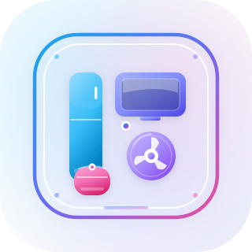

<div align="center">



# রহমান ইলেকট্রনিকস

**A catalog website for a local electronics and home-appliance shop.**

Browse fridges, rice cookers, TVs, fans and small appliances. Check prices and stock before visiting the shop.

<p align="center">
  <a href="https://nextjs.org"></a> <a href="https://react.dev"></a> <a href="https://www.typescriptlang.org"></a> <a href="https://tailwindcss.com"></a> <a href="https://www.mongodb.com"></a> <a href="https://bun.sh"></a> <a href="#"></a>
</p>

</div>

---

> [!NOTE]
> **Where this came from**
>
> This app started as a prototype built by Vercel v0 AI. I first tried my OpenCode model, but it could not generate the app successfully, so I switched to v0. v0 built it with Next.js, and the code was already well written and almost complete using mock data. I then connected it directly to a database.
>
> Following industry standards was not a priority here. This is just a CRUD application, and AI did a pretty good job with it.

## Features

**Storefront**
- Browse products by category, search by name and filter the catalog
- Product detail pages with images, specs, price and availability
- Visit information: phone, WhatsApp, opening hours and an embedded map
- Bengali UI, responsive layout and light/dark themes

**Admin**
- Single-admin login using environment variables
- Dashboard with product and stock counts
- Create, edit and delete products
- Cloudinary image uploads with drag-to-reorder
- Manage specs and toggle published, featured and availability
- Create, edit and delete categories
- One-click reset back to the demo catalog

## Tech stack

Next.js 16 (App Router) · React 19 · TypeScript · Tailwind CSS v4 · shadcn/ui · MongoDB + Mongoose · Cloudinary · Bun

## Quick start

```bash
bun install
cp .env.example .env.local
```

Fill in `.env.local`, then seed the database and start the app:

```bash
bun run seed
bun run dev
```

Open [http://localhost:3000](http://localhost:3000). The admin panel is at `/admin`.

### Environment variables

| Variable | Required | Purpose |
| --- | --- | --- |
| `MONGODB_URI` | Yes | MongoDB connection string |
| `MONGODB_DB` | No | Database name when the URI does not include one |
| `ADMIN_USERNAME` | Yes | Admin login username |
| `ADMIN_PASSWORD` | Yes | Admin login password |
| `AUTH_SECRET` | Yes | Secret used to sign the session cookie |
| `NEXT_PUBLIC_SITE_URL` | No | Public origin for metadata, robots and sitemap |
| `CLOUDINARY_CLOUD_NAME` | No | Enables product image uploads |
| `CLOUDINARY_API_KEY` | No | Cloudinary API key |
| `CLOUDINARY_API_SECRET` | No | Cloudinary API secret (server only) |
| `DNS_SERVERS` | No | Custom DNS servers for `mongodb+srv` lookups |

## Scripts

| Command | Description |
| --- | --- |
| `bun run dev` | Start the development server |
| `bun run build` | Create a production build |
| `bun run start` | Start the production server |
| `bun run seed` | Reset MongoDB with the demo catalog |
| `bunx tsc --noEmit` | Type-check the project |

## Project notes

- Shop details (name, address, phone, hours) live in `lib/shop-config.ts`.
- Demo products and categories live in `lib/mock-data.ts`.
- Architecture, conventions and agent instructions are in [`AGENTS.md`](./AGENTS.md).
- There is no cart, checkout, payment or customer account. Customers visit the shop in person.

<div align="center">
<sub>Built with Next.js, MongoDB and a lot of AI help.</sub>
</div>
